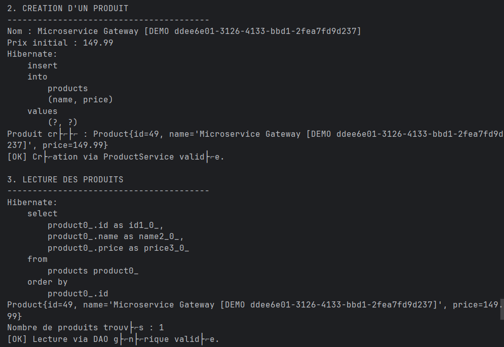
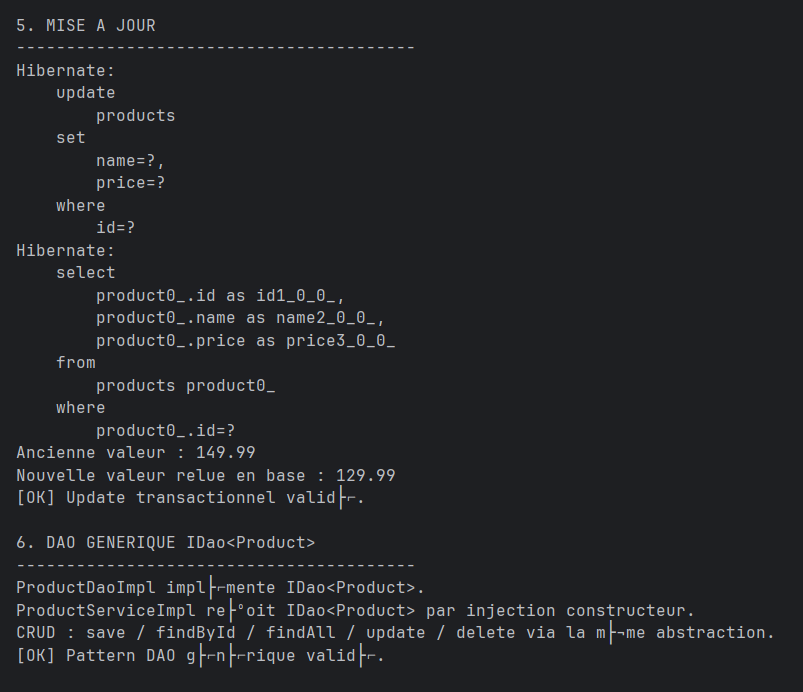
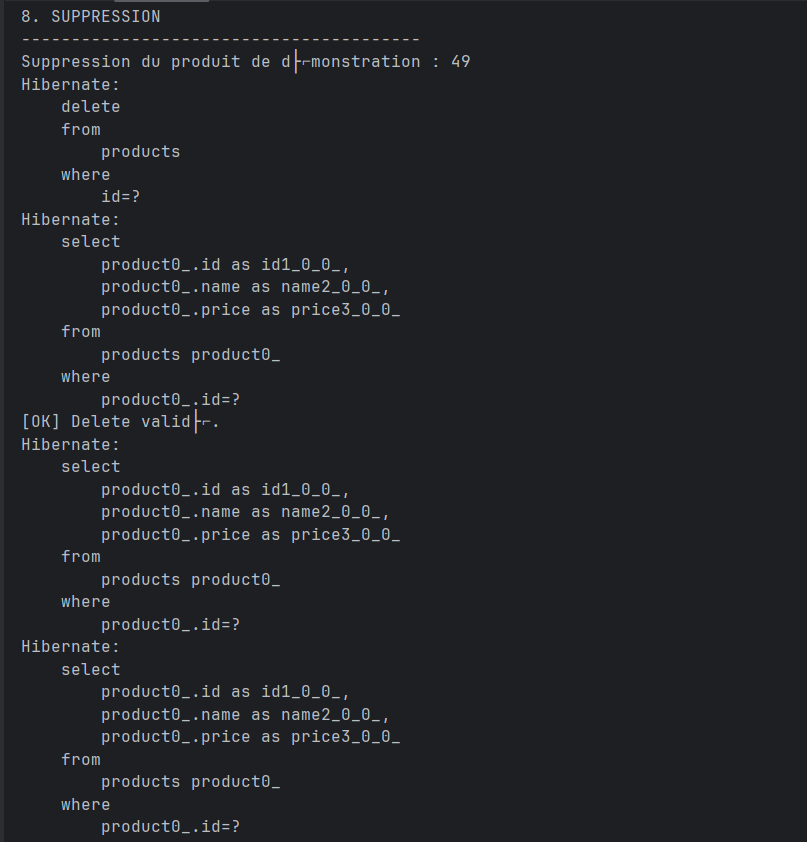

# Microservice Product - Spring & Hibernate

## 1. Création et lecture d'un produit

Création d'un produit via la couche service puis récupération des produits enregistrés avec Hibernate.

## 2. Mise à jour et DAO générique

Mise à jour transactionnelle d'un produit et validation du pattern DAO générique `IDao<Product>`.

## 3. Suppression d'un produit

Suppression transactionnelle du produit de démonstration et vérification de l'opération avec Hibernate.
